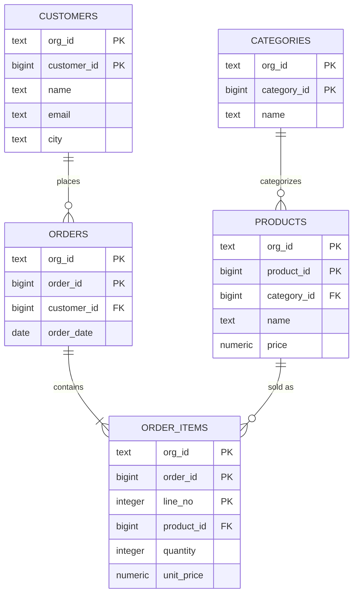

# Step 5 notes — relational databases and normal forms with Neon

## What this step does

The notes server from steps 2–4 is gone. In its place: a Neon Postgres
database holding a year of sales data, taken from a flat spreadsheet
through 1NF, 2NF and 3NF, with read-only tools over the normalized result.
Auth stays in D1 (shared with step 4, unchanged).

## Architecture decisions

- **Driver: `@neondatabase/serverless`'s `neon()` HTTP function**, not its
  WebSocket `Pool`/`Client`. Neon's own docs say WebSocket connections
  can't outlive a single Workers request and point to Cloudflare
  Hyperdrive instead once that's needed — which is why this course
  introduces Hyperdrive at step 6, not here. Every query in this step is a
  single `fetch()`, which fits read-only, single-statement tools exactly.
- **Migrations run from the developer's machine**, never from the Worker:
  `db/migrate.ts` applies `db/migrations/*.sql` in order, tracked in a
  `schema_migrations` table, each file atomic via `sql.transaction()`.
  Splitting a file into statements on `;` is a simplification (it would
  break on a dollar-quoted function body) — fine for this course's plain
  DDL/DML, and the reason to keep migrations that way.
- **`db/query.ts` and `db/seed-my-company.ts`** are the same idea applied
  to one-off needs: an ad-hoc SQL runner for the terminal (`npm run
  query "..."`), and a script that copies the demo company's data into
  your own signed-in company by matching on name/email, never by reusing
  a demo-company id (ids aren't shared across companies).
- **Sharing D1 with step 4 needs the same `BETTER_AUTH_SECRET`, not just
  the same database.** Discovered the hard way: step 5's Worker got its
  own freshly generated secret, and every OAuth sign-in from Claude/
  ChatGPT failed with `BetterAuthError: Failed to decrypt private key`.
  Better Auth's `jwt()` plugin stores its signing key *encrypted* in the
  shared database, under whichever secret was active when step 4 first
  created it - a different Worker reading that same database with a
  different secret simply can't decrypt it. Fixed by setting the exact
  same `BETTER_AUTH_SECRET` on both `learn-mcp-step-04` and
  `learn-mcp-step-05` (`wrangler secret put ... --name <worker>` targets a
  Worker without `cd`-ing into its folder) and clearing the one already-
  encrypted key (`delete from jwks`) so it regenerates under the shared
  secret. Redeploying both Workers afterwards mattered too - our own
  `getAuth()`/`getSql()` lazy-singleton pattern (see step 4's NOTES.md)
  caches per isolate, so a warm isolate from before the secret change
  kept signing under the old one until a fresh deploy recycled it.
- **Tenant scoping**: every table in the final schema carries `org_id` in
  its primary key *and* every foreign key (book lesson 19.7), so no row
  can ever reference another company's row, even by mistake.

## The 1NF → 2NF → 3NF walkthrough

### Starting point: `staging.flat_sales`

One row per order line, with the customer's and the product's details
repeated on every row that mentions them — exactly how a sales team would
export a spreadsheet. Three anomalies, found by query before anything was
fixed:

**Update anomaly.** Maria Lopez's city is spelled two different ways
across her own order lines:

```sql
select distinct customer_name, customer_city from staging.flat_sales where customer_name = 'Maria Lopez';
-- 'Maria Lopez' | 'Austin'
-- 'Maria Lopez' | 'Austin, TX'
```

Because her city is copied onto every row instead of stored once, there's
no single place to fix it — and here it had already drifted out of sync.

**Delete anomaly.** Derek Chen appears in exactly one order line:

```sql
select customer_name, count(*) from staging.flat_sales group by customer_name having count(*) = 1;
-- 'Derek Chen' | 1
```

Delete that one row (say, a cancelled order) and every trace that Derek is
a customer — his email, his city — disappears with it.

**1NF violation.** Noah Patel's first order crams two products into one
cell:

```sql
select * from staging.flat_sales where product_name like '%,%';
-- 'Desk Lamp, USB Cable' | 'Office, Electronics' | 32.49
```

Once a cell names two things, `product_price` stops meaning "the price of
one thing" — there's no way to tell from the data whether 32.49 is one
item's price, the other's, or both combined.

### 1NF: one value per cell, no repeating groups

Migration `0002_1nf.sql` splits Noah's row into two rows, one product
each, with its own real price. The rest of the table already had one
value per cell, so that's the only change 1NF requires.

### 2NF: every non-key column depends on the *whole* key

This only matters for a table with a composite key. `flat_sales` has a
single surrogate key, `order_line_id` — there's no way for a column to
depend on *part* of a one-column key, so 2NF holds automatically here.
Not every table needs 2NF work, and this one didn't.

### 3NF: no column depends on another non-key column

This is the one that actually bites. `customer_email` and `customer_city`
don't depend on `order_line_id` (the key) — they depend on `customer_name`,
itself just another non-key column. Same for `product_category` and
`product_price`, which depend on `product_name`. That's a transitive
dependency (key → non-key column → another non-key column), and it's
exactly what caused both anomalies above.

Migration `0003_3nf.sql` builds the real decomposition: `categories`,
`customers`, `products`, `orders`, `order_items`. Normalizing also forced
a decision the flat table let us dodge — which of Maria's two cities is
actually correct? The migration resolves it to `'Austin'` (2 of her 3
orders) explicitly, rather than picking one arbitrarily. Verified after
running it:

```sql
select name, email, city from customers where email = 'maria.lopez@example.com';
-- 'Maria Lopez' | 'maria.lopez@example.com' | 'Austin'
```

One row, one city — and a `unique (org_id, email)` constraint means there
can never be a second one. The update anomaly isn't just fixed, it's now
structurally impossible.

### The copy kept on purpose

`order_items.unit_price` deliberately breaks the "store each fact once"
instinct: it's the price the customer actually paid on that line, copied
at the time of sale. If `products.price` changes later, past sales must
not silently change with it — so this one duplication is intentional, not
a normalization miss.

## Entity-relationship diagram



## Deployment and cross-client testing

Deployed and verified in both Claude and ChatGPT. Confirmed working:
`describe_schema` returns the real catalog-sourced structure (not a
hardcoded description), and `answer_business_question("best_customers")`
returns the correctly tenant-scoped data for the signed-in company (James
Okafor as top customer, matching the seeded demo dataset exactly) - not
the demo company's data and not another company's.

Note for anyone following these notes: `npm run seed -- <org-id>` run
from a learner's own machine is the documented path, but it's also safe
to run the same five INSERT statements directly against Neon (through
the official Neon MCP connector, or the SQL Editor in the Neon console)
if the script's local run doesn't take for some reason - it's just plain
SQL, nothing Worker-specific.

## Not yet done

- SSO (the step's optional last prompt, carried over as optional from
  step 4) - not attempted.
